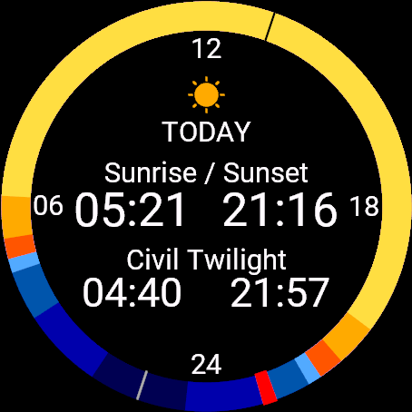
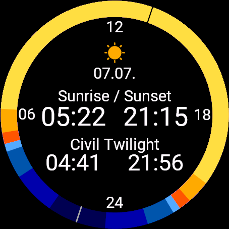
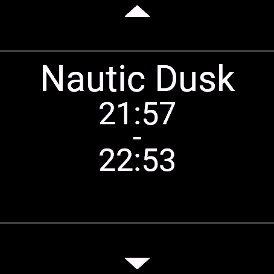
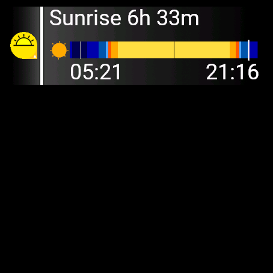

# SunCalc — User Guide

SunCalc shows the sun's schedule for your location: sunrise and sunset, the
three twilight phases (civil, nautical, astronomical), the blue hour and the
golden hour. It works as a widget/glance on your Garmin watch and needs only
a GPS position — no phone connection or account.

---

## Front page: the 24-hour ring

The ring is a 24-hour clock: **noon (12) at the top, midnight (24) at the
bottom**, 06:00 on the left and 18:00 on the right. It is coloured by how high
the sun is through the day:

- deep blue — night / astronomical twilight
- blue — nautical and civil twilight
- red-orange — the **blue hour** glow around sunrise and sunset
- gold — **sunrise / sunset**
- pale gold — the **golden hour** into full daylight

Markers on the ring:

- **red arc** — the current time (shown only for today)
- **black tick** — solar noon (sun at its highest)
- **light tick** — solar midnight (sun at its lowest)

Below the sun icon:

- **TODAY** (or the date when you scroll to another day)
- two rows of times, each showing the **morning time on the left** and the
  **evening time on the right**. By default the top row is *Sunrise / Sunset*
  and the bottom row is *Civil Twilight*. Both rows are configurable
  (see [Settings](#settings)).

---

## Scroll through the days

Press **Up** or **Down** (or swipe) on the ring to step one day back or
forward. The header changes from **TODAY** to that day's **date** (day.month),
and every time on the screen updates to the selected day. The red current-time
marker disappears because it only applies to today.

Leaving and reopening the widget returns you to today.

---

## Details: every phase of the day

**Tap the screen** or press **Start** on the ring to open the details list.
Here each period of the day is shown one at a time with its start and end time:

Astronomical dawn · Nautical dawn · Blue hour · Civil dawn · Sunrise ·
Golden hour · Morning · Afternoon · Golden hour · Sunset · Civil dusk ·
Blue hour · Nautical dusk · Astronomical dusk · Night.

Use **Up / Down** to move between periods and **Back** to return to the ring.
Periods you are not interested in can be hidden (see [Settings](#settings)).

---

## Glance

In the watch's glance carousel, SunCalc shows a compact preview: a **countdown
to the next event** (e.g. *Sunrise 6h 33m*), the 24-hour twilight bar with the
current-time marker, and the morning/evening times. Tap it to open the full
app.

The glance uses the last known GPS position, so it stays populated even when
the watch has not taken a fresh fix recently.

---

## Settings

Open the app settings in **Garmin Connect → your device → SunCalc**:

- **Dark theme** — white on black (default) or black on white.
- **Ring: top row** and **Ring: bottom row** — choose what each row of the
  ring shows.
- **Glance topic** — choose which event the glance counts down to.

Each of the three can be set to any of: *Sunrise / Sunset*, *Civil Twilight*,
*Nautical Twilight*, *Astronomical Twilight*, *Blue Hour*, *Golden Hour*.

The same settings screen has **Show …** switches to hide the periods you don't
want in the details list. These can also be toggled on the watch: open the
details list and press **Menu**.

---

## Languages

SunCalc follows the watch's system language. It is translated into English,
German, French, Spanish, Italian, Dutch and Portuguese; other languages fall
back to English.

---

## GPS

SunCalc needs a position to compute the sun times. On first use, step outside
so the watch can get a GPS fix; after that it reuses the last known position.
If no position is available yet, the screen shows **Waiting for GPS** — open
the full app once outdoors to acquire a fix.
